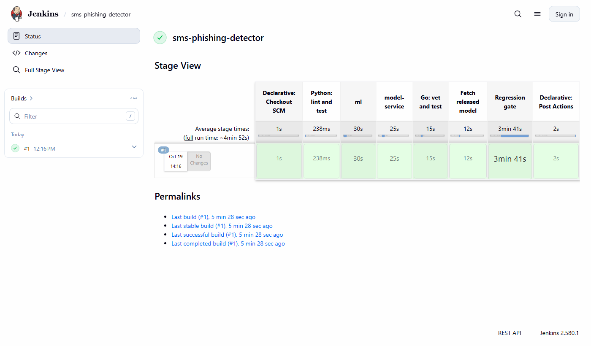

# SMS phishing detector

Classifies SMS messages as **legitimate**, **spam** or **smishing** (SMS phishing), serves
the model behind a Go screening service, and blocks releases that make the model worse.

```
                 POST /v1/screen                     POST /predict
  client ───────────────────────────► Go gateway ──────────────────► model service
                {"text": "..."}       verdict:        (Python, FastAPI,
                                      allow/flag/      ONNX Runtime, int8
                                      block            DistilBERT)
                                         │
                                         └─ /metrics ──► Prometheus

  CI (GitHub Actions and Jenkins):
    lint + unit tests (Python, Go)  →  fetch released model  →  compose up
      →  Go regression gate: re-score the held-out test set through the gateway,
         fail the build if macro F1 drops or the false-positive rate rises
```

## Results

Held-out test set: 828 messages (691 ham, 62 spam, 75 smishing), scored once. Full details,
plots and error analysis in the [notebook](ml/notebooks/01_train_and_evaluate.ipynb).

| Model | Macro F1 (95% CI) | FPR | Smishing recall | Smishing precision | Size | CPU latency p50 / p95 |
|---|---|---|---|---|---|---|
| TF-IDF + logistic regression | 0.855 (0.809–0.897) | 0.43% (3 of 691) | 0.840 | 0.863 | | |
| DistilBERT, ONNX fp32 | 0.881 | 0.14% (1 of 691) | 0.853 | 0.901 | 256 MiB | 8.7 / 15.2 ms |
| **DistilBERT, ONNX int8 (shipped)** | **0.890 (0.847–0.929)** | **0.14% (1 of 691)** | **0.880** | **0.904** | **64 MiB** | **4.3 / 8.4 ms** |

- **DistilBERT vs the baseline.** A paired bootstrap gives +0.035 macro F1 for DistilBERT,
  ahead in 94% of resamples. The 95% interval (−0.005 to +0.079) still just includes zero,
  so on 137 minority-class test messages the honest claim is "very likely better", with a
  third of the false positives.
- **int8 vs fp32.** The quantised model is 4x smaller and twice as fast on CPU with no
  accuracy loss. Its slightly higher test score is noise; on validation the two are level.
- **Validation (0.95) vs test (0.89).** With 60–75 messages per minority class, one message
  moves a class's F1 by more than a point. The bootstrap intervals show the range.
- **Errors.** The most confident mistakes are messages labelled spam that read as jokes,
  chain messages or quizzes, several arguably mislabelled. Spam and smishing overlap on
  premium-rate prize messages. The one false positive is a legitimate prepaid top-up
  confirmation.

Training: 3 epochs on a laptop RTX 4050 in 40 seconds, reproducible to the byte.

### What the gate caught while building this

- **The offline evaluation did not match production.** The first gate run measured the
  int8 model at 0.890 through the service; the notebook said 0.885. Dynamic int8
  quantisation picks its activation scale from the whole input tensor, padding included,
  and the notebook scored padded batches of 64 while the service scores one message at a
  time. The notebook now scores ONNX models the way the service does, and the numbers
  agree exactly.
- **A broken release.** Shipping the same model with `labels.json` in the wrong order
  (spam and smishing swapped) drops macro F1 to 0.41. The gate fails the build with exit
  code 1. The FPR check alone would have passed it, because legitimate messages are
  unaffected.

## What is in here

| Path | What it is |
|---|---|
| [`ml/notebooks/01_train_and_evaluate.ipynb`](ml/notebooks/01_train_and_evaluate.ipynb) | Data preparation, baseline, DistilBERT training, ONNX export, evaluation, error analysis |
| [`ml/src/smishing/`](ml/src/smishing/) | The code the notebook calls: data, baseline, training, export, metrics |
| [`model-service/`](model-service/) | FastAPI inference service. ONNX Runtime and the Rust `tokenizers` library, no PyTorch |
| [`cmd/gateway/`](cmd/gateway/), [`internal/screen/`](internal/screen/) | Go screening service with Prometheus metrics |
| [`cmd/evalgate/`](cmd/evalgate/), [`internal/gate/`](internal/gate/), [`internal/evalmetrics/`](internal/evalmetrics/) | Go regression gate |
| [`release-metrics.json`](release-metrics.json) | Test-set metrics of the released model. The gate's baseline |
| [`.github/workflows/ci.yml`](.github/workflows/ci.yml), [`Jenkinsfile`](Jenkinsfile) | The same pipeline in GitHub Actions and Jenkins |
| [`ci/jenkins/`](ci/jenkins/) | Local Jenkins, configured as code |

## Data and leakage

Dataset: Mishra & Soni, *SMS Phishing Dataset for Machine Learning and Pattern Recognition*,
Mendeley Data, [DOI 10.17632/f45bkkt8pr.1](https://doi.org/10.17632/f45bkkt8pr.1),
licensed CC BY 4.0. 5,971 messages: 4,844 ham, 489 spam, 638 smishing.

Two kinds of duplication are handled before splitting:

- **Exact duplicates** are dropped. Texts that appear with two different labels are dropped
  entirely, because their ground truth is ambiguous.
- **Template variants** are kept but grouped. A scam campaign sends one text with a
  different link or amount each time. The template key lowercases the text and masks
  links and digits, and the split (`StratifiedGroupKFold`) keeps every variant of a
  template on the same side. With a plain random split, variants land in both train and
  test, and the test score rewards memorisation.

The split is roughly 72/14/14. Model choices are made on validation; the test set is scored
once, at the end of the notebook. A unit test checks that no template key appears in two
splits.

How much this matters: with a plain random split, 2.8% of test messages overall, and **30%
of the smishing messages**, have a template twin in the training set. The baseline scores
0.888 macro F1 on that leaky split against 0.855 on the grouped one.

After cleaning: 106 exact duplicates and 34 texts with conflicting labels (68 rows) removed,
5,797 messages left.

## Metrics

- **Macro F1**: the unweighted mean of per-class F1, so the small smishing class counts as
  much as ham.
- **FPR (false-positive rate)**: the share of legitimate messages labelled spam or smishing.
  In a messaging product each false positive is a real message the customer never gets,
  so FPR is gated separately instead of being averaged into F1.

The Python ([`metrics.py`](ml/src/smishing/metrics.py)) and Go
([`evalmetrics.go`](internal/evalmetrics/evalmetrics.go)) implementations share test cases,
so the notebook and the gate report the same numbers.

## The regression gate

`evalgate` sends every test message through the running gateway with a pool of concurrent
workers, computes the metrics and compares them with `release-metrics.json`:

| Check | Fails when |
|---|---|
| macro F1 | it drops by more than 0.01 |
| FPR | it rises by more than 0.005 |

Exit code 0 means pass, 1 a regression, 2 that the gate could not run. Because it goes
through the real HTTP path, it also catches problems the notebook cannot: a tokenizer that
differs from training, a broken export, a wrong label order.

To release a new model, train and export it, then record its metrics as the new baseline:

```sh
go run ./cmd/evalgate -write-release -model-version model-v2
```

## Run it

Requirements: Docker. For development also Go 1.27 and [uv](https://docs.astral.sh/uv/).

```sh
sh scripts/fetch-model.sh                                # released model → model-service/model/
docker compose up -d --build --wait model-service gateway

curl -s localhost:8080/v1/screen -H 'Content-Type: application/json' \
  -d '{"text":"Your parcel is on hold. Pay the 1.99 fee at parcel-redelivery.co/pay"}'
# {"verdict":"block","label":"smishing","scores":{...}}

docker compose run --rm evalgate                         # the regression gate
docker compose --profile monitoring up -d prometheus     # Prometheus on :9090
```

Gateway metrics at `localhost:8080/metrics`:

| Metric | Type | Meaning |
|---|---|---|
| `screen_requests_total{verdict}` | counter | messages by verdict |
| `screen_errors_total{reason}` | counter | rejected requests and model failures |
| `screen_latency_seconds` | histogram | end-to-end latency, model call included |
| `model_smishing_score` | histogram | distribution of the smishing probability; a shift is an early drift signal |

Tests:

```sh
go vet ./... && go test ./...
cd ml && uv run pytest && cd ../model-service && uv run pytest
```

Training (needs a GPU for reasonable speed; the notebook runs on CPU too, slowly):

```sh
cd ml
uv sync --group train
uv run jupyter lab notebooks/01_train_and_evaluate.ipynb
```

### Jenkins

```sh
docker compose -f ci/jenkins/compose.yaml up -d --build
```

Open <http://localhost:8081> (admin / admin) and run the `sms-phishing-detector` job.
Plugins and the pipeline job are defined in [`ci/jenkins/`](ci/jenkins/), so the
setup is reproducible.


